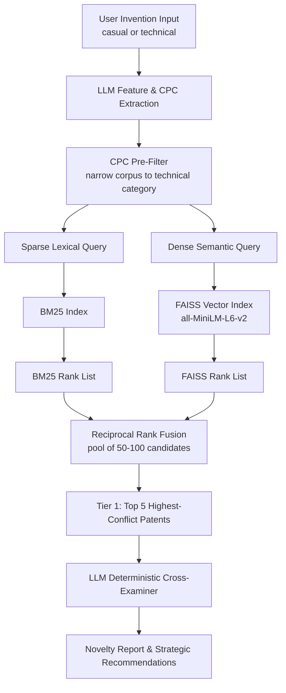

# Intelligent Patent Prior-Art Search & Novelty Assessment System

An end-to-end **Retrieval-Augmented Generation (RAG)** platform that helps inventors, researchers, and engineers check whether an idea is novel, in minutes instead of days.

Submit an idea in any form, from a casual two-line concept to a full research paper draft. The system finds the closest prior art and produces a legal-style, element-by-element novelty report.

**Team:** Risheek, Rudra, Rajveer, Om, Vanshika
**Department:** Computer Science & Engineering (AI & ML), Unitedworld Institute of Technology (UIT)

---

## Table of Contents

- [What It Does](#what-it-does)
- [Why Not Just Use a Chatbot?](#why-not-just-use-a-chatbot)
- [Architecture](#architecture)
- [Core Algorithms](#core-algorithms)
- [Example Walkthrough](#example-walkthrough)
- [Novelty Overlap Risk Score](#novelty-overlap-risk-score)
- [Data Contracts](#data-contracts)
- [Tech Stack](#tech-stack)
- [Core Dependencies](#core-dependencies)
- [Project Status](#project-status)
- [Disclaimer](#disclaimer)
- [Team](#team)

---

## What It Does

1. **Claim formalization.** Translates the raw idea into patent-grade claim elements and Cooperative Patent Classification (CPC) codes.
2. **Hybrid retrieval.** Searches patent corpora by combining sparse lexical matching (**BM25**) with dense semantic vector search (**FAISS**).
3. **Rank fusion.** Merges both result lists with **Reciprocal Rank Fusion (RRF)** to remove score-scale bias and surface the true top-K prior art.
4. **LLM cross-examination.** Uses a Large Language Model, run deterministically, to produce an **Element-by-Element Novelty Assessment Matrix** with overlap risk scores, claim citations, and technical differentiation strategies.

---

## Why Not Just Use a Chatbot?

| Problem with a vanilla LLM | How this system addresses it |
|---|---|
| **Hallucinated patents.** Fabricated patent numbers, dates, and claims. | **Grounded RAG.** The LLM cannot cite from memory. It reasons only over real documents retrieved from the corpus. |
| **Stale knowledge.** Static training cutoffs miss recent grants. | **Live data ingestion** from USPTO / PatentsView repositories. |
| **Scale.** 11M+ patents cannot fit in a context window. | **Two-stage retrieval.** BM25 and FAISS rank 50 to 100 candidates quickly, and only the top 5 go to the LLM. |
| **No legal workflow.** Chat summaries ignore examiner standards. | Automates CPC mapping, Claim 1 isolation, and structured analysis under **35 U.S.C. § 102** (novelty) and **§ 103** (non-obviousness). |

---

## Architecture



### Two-Stage Retrieval

- **Stage 1: high-recall candidate retrieval.** BM25 and FAISS score a pool of 50 to 100 patents in milliseconds.
- **Stage 2: deep deterministic evaluation.** The LLM analyzes only the **Top 5** (Tier 1) patents, focusing on independent **Claim 1**.
- **Tier 2** (the remaining candidates) appears in an extended landscape table with similarity scores and an **Analyze on Demand** option.

This design avoids the "lost in the middle" context problem, API timeouts, and wasted effort on narrower dependent claims.

---

## Core Algorithms

### BM25 (sparse lexical)
Keyword ranking with term-frequency saturation and inverse document frequency. It excels at exact technical terms, part numbers, and units (for example `LiFePO4` or `802.11ax`) that semantic models tend to smooth over.

### FAISS (dense semantic)
Meta AI's vector similarity library. Text is embedded with Sentence-BERT (`all-MiniLM-L6-v2`) and compared by cosine similarity. It bridges the gap between plain-language ideas and formal patent wording.

### Reciprocal Rank Fusion (RRF)
BM25 and cosine scores are on incompatible scales, so RRF uses **rank position only**:

```
RRF Score(d) = Σ  1 / (k + rank_m(d))      k = 60,  m ∈ {BM25, FAISS}
```

A patent ranked 2nd in BM25 and 1st in FAISS scores `1/62 + 1/61 ≈ 0.0325`. An outlier ranked 1st in BM25 but 80th in FAISS scores only `≈ 0.0235`.

---

## Example Walkthrough

**Input (raw idea):** a smart backpack for students that charges itself with solar cells and sounds an alarm when someone lifts or opens it while it is not being worn.

**Step 1: extraction**
- Element A: padded wearable carrier body
- Element B: flexible photovoltaic charging surface
- Element C: accelerometer-triggered audible alarm
- Element D: USB output port with internal battery
- CPC codes: `A45C 13/18`, `H02J 7/35`, `G08B 13/14`

**Step 2: hybrid retrieval.** BM25 matches terms like *photovoltaic* and *accelerometer*. FAISS links *"alarm if someone lifts it"* to *"motion-triggered theft deterrent siren"*. RRF produces the final ranking.

**Step 3: novelty matrix**

| User Element | Status | Basis |
|---|---|---|
| A: Wearable carrier body | Anticipated | Disclosed in Claim 1 of a retrieved patent |
| B: Photovoltaic surface | Partially anticipated | Rigid panel disclosed; flexible laminate is not |
| C: Motion-triggered alarm | Anticipated | Disclosed in Claim 3 of a retrieved patent |
| D: USB charging interface | Anticipated | Disclosed in Claim 1 of a retrieved patent |

**Computed overlap risk: 75% (High).** Broad claims would likely be rejected under § 102 / § 103.

**Step 4: white-space pivot.** Focus claims on adaptive power-aware alarm logic and a tamper-sensing conductive-fiber strap.

---

## Novelty Overlap Risk Score

```
Overlap (%) = (user elements anticipated in retrieved claims / total extracted user elements) × 100
```

| Range | Risk | Interpretation |
|---|---|---|
| 0% – 30% | Low | Strong patentability potential |
| 31% – 70% | Moderate | Core concept exists; patentability depends on specific mechanism or geometry claims |
| 71% – 100% | High | Directly anticipated; likely § 102 rejection |

---

## Data Contracts

All modules share three JSON contracts so they can be developed in parallel. The examples below are illustrative.

<details>
<summary><b>Contract A: Extracted Features</b></summary>

```json
{
  "user_query_raw": "Smart backpack with solar charging and theft alarm...",
  "technical_domain": "Portable Power / Anti-Theft Wearables",
  "cpc_codes": ["A45C 13/18", "H02J 7/35", "G08B 13/14"],
  "extracted_elements": [
    {"element_id": "EL_1", "description": "Padded carrier body with shoulder straps"},
    {"element_id": "EL_2", "description": "Flexible photovoltaic charging surface"},
    {"element_id": "EL_3", "description": "Accelerometer-triggered audible alarm"},
    {"element_id": "EL_4", "description": "USB output port with internal battery"}
  ],
  "search_keywords": ["solar charging backpack", "anti-theft motion alarm", "photovoltaic bag"]
}
```
</details>

<details>
<summary><b>Contract B: Cleaned Patent Schema</b></summary>

```json
{
  "patent_id": "US-9642871-B2",
  "title": "Anti-theft carrying bag with accelerometer-triggered alarm",
  "cpc_codes": ["A45C 13/18", "G08B 13/14"],
  "abstract": "A carrying bag whose motion sensor sounds an alarm upon unauthorized movement...",
  "claim_1": "1. A portable carrier apparatus comprising: a padded carrier body; an accelerometer coupled to an audible alarm module...",
  "source_url": "https://patents.google.com/patent/US9642871B2/en"
}
```
</details>

<details>
<summary><b>Contract C: Final Novelty Assessment</b></summary>

```json
{
  "novelty_overlap_score": 75.0,
  "verdict": "Moderate-to-High Novelty Risk",
  "prior_art_matches": [
    {
      "patent_id": "US-9642871-B2",
      "title": "Anti-theft carrying bag with accelerometer-triggered alarm",
      "rrf_score": 0.0324,
      "mapped_elements": [
        {"element_id": "EL_1", "status": "Anticipated", "citation": "Claim 1, lines 4-8"},
        {"element_id": "EL_3", "status": "Anticipated", "citation": "Claim 3, lines 1-3"}
      ]
    }
  ],
  "patentability_pivot_recommendations": [
    "Focus patent claims strictly on adaptive power-aware alarm logic that scales sensing with battery charge and solar input.",
    "Claim a conductive-fiber strap that signals cutting or tampering without added sensors."
  ]
}
```
</details>

### LLM Prompt Settings

| Stage | Role | Temperature | Output |
|---|---|---|---|
| 1: Feature & CPC extraction | Patent Examination Assistant | 0.1 | JSON (Contract A) |
| 2: Cross-examination | USPTO Patent Examiner | 0.0 | JSON (Contract C) |

---

## Tech Stack

| Layer | Technology |
|---|---|
| Sparse retrieval | BM25 |
| Dense retrieval | FAISS + Sentence-BERT (`all-MiniLM-L6-v2`) |
| Fusion | Reciprocal Rank Fusion (k = 60) |
| Classification | CPC pre-filtering |
| Reasoning | Large Language Model (deterministic, temperature 0) |
| Data sources | USPTO / PatentsView |

---

## Core Dependencies

The retrieval layer is built on these open-source Python libraries:

```bash
pip install rank-bm25 faiss-cpu sentence-transformers numpy
```

---

## Project Status

The project is currently at **Review 1**, with the full engineering specification, terminology, architecture, data contracts, and prompt templates complete.

| Milestone | Status |
|---|---|
| System specification and architecture blueprint | Done |
| Data contracts (A, B, C) and LLM prompt templates | Done |
| Patent data ingestion (USPTO / PatentsView) | In progress |
| CPC pre-filter, BM25 index, and FAISS index | Planned |
| RRF fusion engine | Planned |
| LLM extraction and cross-examination modules | Planned |
| Tier 2 landscape table with "Analyze on Demand" | Planned |
| Web interface and report export | Planned |

---

## Disclaimer

This tool provides **preliminary, informational** prior-art analysis for research and education. It is **not legal advice** and does not replace a professional patent search or a registered patent attorney.

---

## Team

Risheek · Rudra · Rajveer · Om · Vanshika

**Unitedworld Institute of Technology (UIT)**, Department of Computer Science & Engineering (AI & ML)
